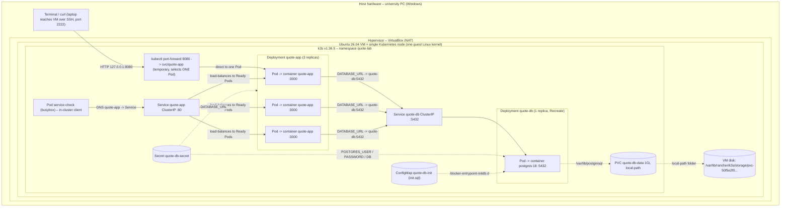

# Lab 52 – Architecture notes

Lab 42 results (health paths, 3 replicas, Pod replacement, readiness failure/recovery):
[../42-kubernetes/verification.md](../42-kubernetes/verification.md)

## Diagram of the current setup

Nested boxes = "runs inside" (containment). Solid arrows = request traffic.
Dashed arrows = configuration / storage references.



## Database checks

| Check | Result |
|---|---|
| PVC | `quote-db-data` **Bound**, 1Gi, RWO, `local-path` |
| DB Pod before | `quote-db-796c9c9d49-79d4h` 1/1 Ready |
| Quote inserted via app | marker `res509-1794906420` returned by `GET /` |
| Replacement | `kubectl rollout restart deployment/quote-db` |
| DB Pod after | `quote-db-586ccdcb8c-lqmz9` 1/1 Ready (new Pod, same PVC) |
| Quote after replacement | `res509-1794906420` still returned by `GET /` |

```
# before
quote-db-796c9c9d49-79d4h   1/1   Running
    <div>res509-1794906420</div>
# after
quote-db-586ccdcb8c-lqmz9   1/1   Running
    <div>res509-1794906420</div>
quote-db-data   Bound   pvc-50f5e2f0-ad63-449e-89d3-0648fa968696   1Gi   RWO   local-path
```

Credentials live only in the Secret `quote-db-secret`; manifests reference it
(`envFrom.secretRef` for PostgreSQL, `secretKeyRef` for the app). No Secret export is committed.

## Boundary notes

- **Shared kernel:** the app containers and the PostgreSQL container are processes isolated by
  namespaces and cgroups, but they all run on the Ubuntu VM's single guest kernel. The hypervisor
  (VirtualBox) provides the VM boundary; Kubernetes only manages workloads inside that VM.
- **Persistence boundary:** app Pods are disposable because they hold no state. The quote survived the
  database Pod replacement because the data lives on the PVC, not in the container. But the PVC is a
  `local-path` folder on this one VM's disk, so three app replicas plus this storage give no recovery
  from VM or disk loss; that would need backups and multi-node or replicated storage.

## Main limitation / next action

- Single node and single database instance: replacing the DB Pod causes a short outage (Recreate), and
  losing the VM or its disk loses all data. Next action: add a database backup (e.g. a scheduled
  `pg_dump` stored outside the VM) and discuss multi-node storage in Lab 62.
- Environment note: the university network blocks `get.k3s.io` and Docker Hub, so k3s was installed in
  airgap mode from GitHub release assets (checksums verified), and base images were pulled from
  `public.ecr.aws/docker/library`.
