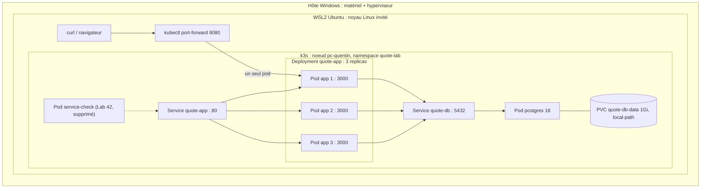

# Lab 52 – Architecture et persistance

Environnement : k3s dans une distribution Ubuntu sous WSL2 (Windows), nœud unique `pc-quentin`, namespace `quote-lab`.

## Schéma de l'installation réelle

Traits pleins : chemins de trafic. Cadres imbriqués : « tourne dans ».
Le pod `service-check` (chemin in-cluster vérifié au Lab 42) a été supprimé ensuite ; il est en pointillés.

## Résultats Lab 42 (cœur + extension liveness)

Voir [../42-kubernetes/verification.md](../42-kubernetes/verification.md).

## Vérification de la base de données

- PVC `quote-db-data` : `Bound` (1Gi, `local-path`), identique avant et après le remplacement du pod.
- Pod PostgreSQL avant : `quote-db-796c9c9d49-fg466` ; après `kubectl rollout restart` : `quote-db-5f55ff4bb9-9sqjp`.
- Citation insérée via l'application (`POST /quotes`) : `res509-1794906160`, retrouvée dans la page avant et après le remplacement.
- Secret `quote-db-secret` référencé par `secretRef` / `secretKeyRef`, jamais commité.
- Sorties complètes : [db-evidence.txt](db-evidence.txt).

## Notes

1. **Noyau partagé** : les conteneurs de l'app et de PostgreSQL tournent sur le même noyau Linux, celui de la distribution WSL2 qui héberge k3s. Ils sont isolés par les namespaces et cgroups, pas par des noyaux séparés. La frontière de machine virtuelle est celle de l'hyperviseur Windows ; Kubernetes ne gère que ce qui tourne à l'intérieur.
2. **Frontière de persistance** : un pod applicatif est jetable, le Deployment en recrée un. La citation survit au remplacement du pod PostgreSQL parce que les données sont sur le PVC, pas dans le conteneur. Mais ce PVC est du `local-path` sur le disque de cette machine : trois replicas et un PVC ne protègent ni contre la perte de la VM ou du disque, ni contre une suppression du PVC.
3. **Limite principale / prochaine action** : un seul nœud, aucune sauvegarde ni réplication de la base, et un seul pod PostgreSQL (indisponibilité pendant son remplacement, stratégie `Recreate`). Prochaine action : tester une sauvegarde/restauration (`pg_dump`) et noter la base comme point unique de défaillance.

## Observation : un pod applicatif a redémarré pendant le remplacement de la base

- Symptôme : `quote-app-6f44677bb9-cxbl9` a `RESTARTS 1`, au moment du `rollout restart` de PostgreSQL.
- Cause : PostgreSQL a coupé les connexions (`57P01`, « terminating connection due to administrator command »). Le pool `pg` a émis un événement `error` non géré, ce qui a arrêté le processus Node ; le kubelet l'a relancé. Ce n'est pas la liveness : `/health` ne touche pas la base.
- Détail : le conteneur affiche `exitCode 0` / `Completed`, car le démarrage est `node server.js | pino-pretty` et un pipeline renvoie le code de sa dernière commande.
- Effet : un seul pod sur trois touché, les autres replicas ont continué de servir.
- Amélioration possible (non faite, nécessite de reconstruire l'image) : écouter l'événement `error` du pool pour éviter le crash. Preuve : [app-restart-evidence.txt](app-restart-evidence.txt).
