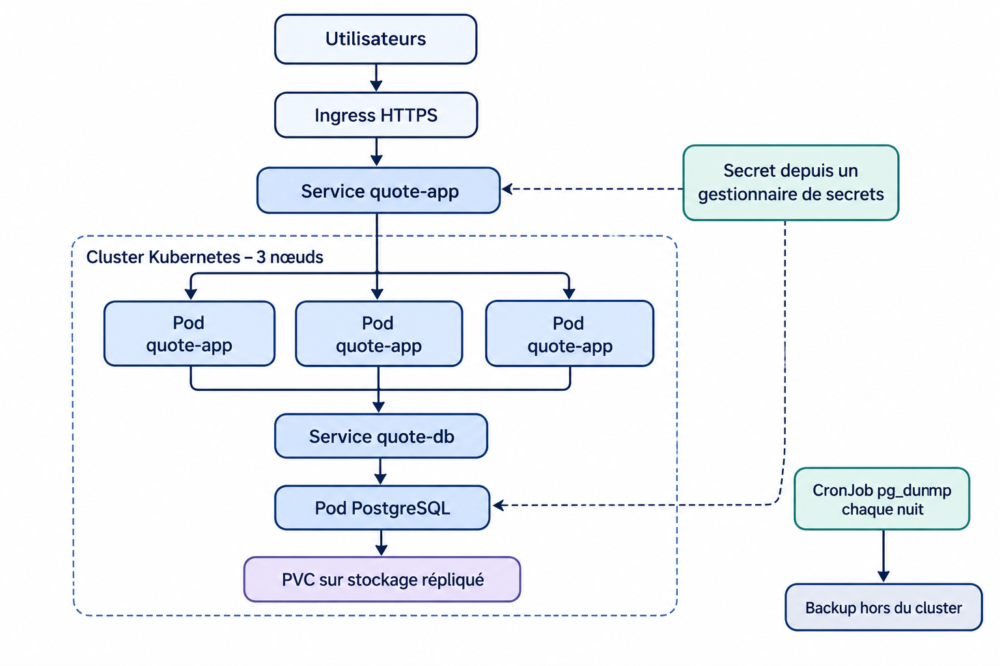

# Final Architecture – Quote API

Pour ce lab je suis reparti de ce que j'ai fait dans les labs 42 et 52 (Deployment, Service, probes, puis PostgreSQL avec un PVC et un Secret). Quand quelque chose a vraiment été testé sur ma VM, je mets « vérifié » ou « testé dans le lab 42/52 ». Le reste, c'est ce que je propose mais que je n'ai pas mis en place.

# Current System Problems

| # | Domaine | Problème | Conséquence | Correction proposée |
|---|---|---|---|---|
| 1 | Disponibilité | Un seul Pod applicatif, stratégie Recreate, aucune probe | Une panne du Pod ou un nouveau déploiement arrête tout le service ; le trafic peut arriver sur un Pod pas encore prêt, et un processus bloqué n'est jamais redémarré | 3 réplicas ou plus derrière un Service, avec des probes readiness et liveness sur /health (vérifié dans le Lab 42), RollingUpdate avec maxUnavailable 0 (proposé) |
| 2 | Données | Les données de la base sont stockées dans la couche d'écriture du conteneur | Chaque redémarrage du conteneur ou remplacement du Pod supprime toutes les citations | PVC monté sur /var/lib/postgresql (vérifié dans le Lab 52) |
| 3 | Données | Un seul nœud et un seul disque, aucune sauvegarde testée | La perte du nœud ou du disque provoque une panne et une perte définitive des données | Sauvegardes pg_dump régulières stockées hors du cluster, restauration testée, cluster multi-nœuds (proposé) |
| 4 | Stabilité | Application et PostgreSQL dans le même conteneur, aucune limite de ressources | Impossible de scaler l'application sans dupliquer la base, chaque mise à jour de l'application redémarre la base, un processus peut utiliser toute la mémoire ou le CPU du nœud et faire tomber les deux | Deployments et Services séparés pour l'application et la base (vérifié dans le Lab 52), requests et limits CPU et mémoire (proposé) |
| 5 | Sécurité | Identifiants écrits en clair dans le manifeste | Le mot de passe reste pour toujours dans l'historique Git et toute personne ayant accès au dépôt peut le lire ; le changer demande un commit | Secret Kubernetes créé en dehors de Git et référencé dans les manifestes (vérifié dans le Lab 52) |
| 6 | Ressources | Aucune request ni limit CPU et mémoire | Un Pod qui consomme trop (fuite mémoire, pic de trafic) peut prendre toute la mémoire ou le CPU du nœud et faire tomber les autres Pods, y compris la base. Le scheduler ne sait pas combien de ressources il faut, et un HorizontalPodAutoscaler ne peut pas fonctionner sans requests CPU | Requests et limits sur chaque conteneur, par exemple 100m CPU / 128Mi en request et 250m / 256Mi en limit pour l'appli, plus de mémoire pour PostgreSQL (proposé) |

# Production Architecture

Les utilisateurs arrivent par un Ingress en HTTPS, qui envoie les requêtes au Service quote-app. Le Service ne donne du trafic qu'aux Pods qui sont Ready, ça je l'ai vu dans le lab 42.

L'appli tourne avec 3 réplicas comme dans mes labs, mais au lieu de les avoir tous sur la même VM je les mettrais sur 3 nœuds différents. Comme ça si un nœud tombe, il reste quand même deux Pods pour répondre. Pour les mises à jour, j'utiliserais un RollingUpdate avec maxUnavailable à 0 : on garde les anciens Pods tant que les nouveaux ne sont pas Ready. Les probes restent sur /health, et je fais exprès qu'elles ne dépendent pas de la base, sinon une panne de la base rendrait tous les Pods de l'appli « pas prêts ». J'ajouterais aussi des requests et des limits sur tous les conteneurs. La request, c'est ce que le scheduler réserve pour le Pod sur un nœud. La limit, c'est le maximum que le conteneur a le droit d'utiliser : s'il dépasse la limite mémoire, il est tué (OOMKilled) et redémarré, mais les autres Pods du nœud ne sont pas touchés. Pour l'appli, je partirais sur 100m CPU / 128Mi en request et 250m / 256Mi en limit, et je donnerais plus de mémoire à PostgreSQL.

Pour PostgreSQL, je garde ce que j'ai fait dans le lab 52 : un Deployment séparé avec un seul Pod, la stratégie Recreate (pour ne jamais avoir deux Postgres sur le même disque) et son propre Service. Les données sont sur un PVC. La différence, c'est qu'en production je n'utiliserais pas local-path, parce que le disque reste coincé sur un seul nœud. Il faudrait un stockage répliqué, par exemple Longhorn ou un disque cloud, pour pouvoir relancer la base sur un autre nœud.

Pour les mots de passe, dans le lab 52 j'ai créé le Secret à la main avec kubectl et les manifestes font juste référence au Secret. En production, je le ferais venir d'un gestionnaire de secrets comme Vault, pour que personne n'ait à le taper ni à le mettre dans Git.

Et surtout il manque un vrai backup. Je mettrais un CronJob qui lance pg_dump chaque nuit et envoie le fichier en dehors du cluster (par exemple sur S3). Un backup qu'on n'a jamais restauré ne sert pas à grand-chose, donc il faut aussi tester la restauration de temps en temps.

**Limites de panne**

Si un Pod de l'appli plante, le ReplicaSet en recrée un et le Service envoie le trafic aux autres en attendant. Normalement l'utilisateur ne voit rien, c'est ce que j'ai observé dans le lab 42 quand j'ai supprimé un Pod. Si c'est le Pod de la base qui plante, Kubernetes le recrée avec le même PVC. Dans le lab 52 j'ai fait un rollout restart de la base et ma citation était toujours là, mais pendant quelques secondes la base n'était pas disponible.

Si on perd un nœud entier, les Pods de l'appli sur les autres nœuds continuent, et la base peut repartir ailleurs si le disque est répliqué. Par contre si c'est le disque qui est perdu ou si les données sont corrompues, le PVC ne sert plus à rien. Là il faut restaurer le dernier backup, et tout ce qui a été écrit après est perdu.

Ce que j'ai compris avec ces labs, c'est que garder le service en ligne et protéger les données, ce n'est pas la même chose. Les réplicas et les probes s'occupent de la disponibilité. Le PVC garde les données quand un Pod est remplacé, mais ce n'est pas un backup. Il n'y a que le backup hors du cluster qui protège si on perd le disque, le nœud ou tout le cluster.

Sur le schéma, ce qui est marqué « proposé » est nouveau. Le reste (appli et base séparées, les deux Services, le PVC et le Secret) je l'ai déjà fait tourner dans le lab 52.

# Operational Strategy

**Montée en charge.** Comme l'appli ne garde rien en mémoire (tout est dans la base), on peut ajouter des réplicas sans problème. On pourrait automatiser ça avec un HorizontalPodAutoscaler sur le CPU, mais il faut des requests CPU et metrics-server pour que ça marche. Si les nœuds sont pleins, on rajoute des nœuds. La base, elle, ne se scale pas comme ça : on ne peut pas juste lancer deux Postgres sur le même disque. Pour l'instant on peut seulement lui donner plus de ressources.

**Mises à jour.** Chaque version a son propre tag d'image. Le RollingUpdate remplace les Pods un par un, et un nouveau Pod ne reçoit du trafic que quand sa readiness passe. Dans le lab 42, j'ai cassé exprès le chemin de la readiness : le rollout s'est bloqué mais les anciens Pods continuaient à répondre, donc personne n'était impacté. Pour vérifier un déploiement je regarde kubectl rollout status, les events et je teste la page. Si la version est mauvaise, kubectl rollout undo remet l'ancienne. Mais attention, ça ne touche que les Pods de l'appli. Si la nouvelle version a modifié la base (une migration par exemple), le rollback ne remet pas l'ancien schéma ni les anciennes données. C'est pour ça qu'il faut des migrations compatibles avec l'ancienne version et un backup juste avant.

**Détection des pannes.** La readiness sort un Pod du Service quand il ne répond plus, et la liveness redémarre un conteneur bloqué. J'ai testé les deux dans le lab 42 : avec la readiness cassée le Pod restait en 0/1 sans redémarrer, avec la liveness cassée le nombre de restarts augmentait. Pour comprendre ce qui se passe, les events sont souvent le plus clair (c'est là que j'ai vu l'erreur 404 de la probe), plus les logs et l'état des Pods. En production il faudrait en plus du monitoring avec des alertes, par exemple Prometheus et Grafana sur les erreurs, le temps de réponse, les restarts et l'espace disque.

**Qui répare quoi.** Le Deployment et son ReplicaSet recréent les Pods qui disparaissent, pour l'appli comme pour la base. Le kubelet redémarre un conteneur quand la liveness échoue. Le scheduler replace les Pods sur un autre nœud si un nœud est perdu. Mais tout ça ne fait que relancer des Pods. Si les données sont perdues ou si tout le cluster est cassé, Kubernetes ne peut rien faire : il faut le backup, une procédure de restore testée, et un moyen de reconstruire les machines (par exemple avec de l'infrastructure as code).

# Weakest Point

Pour moi le point faible, c'est la base de données. Même dans ma version améliorée, il n'y a toujours qu'un seul Pod PostgreSQL. J'ai 3 réplicas de l'appli sur 3 nœuds, mais ils dépendent tous de cette même base. Si elle redémarre ou si son nœud tombe, /health répond encore, mais plus personne ne peut lire ni ajouter de citations jusqu'à ce qu'elle revienne. Avec Recreate et un disque qui doit changer de nœud, ça peut prendre une ou deux minutes.

C'est aussi ce qui casserait en premier avec beaucoup plus de trafic. Ajouter des Pods d'appli c'est facile, mais ils se connectent tous à la même base. Avec 10 fois plus d'utilisateurs, je pense que la base serait à court de connexions ou de CPU bien avant l'appli.

J'ai quand même choisi de garder une seule base parce que c'est beaucoup plus simple à gérer et qu'on n'a pas de problème de cohérence des données. Avec un primaire et un standby (par exemple avec l'opérateur CloudNativePG), la bascule serait beaucoup plus rapide, mais c'est plus compliqué à installer et à maintenir, et ça demande plus de ressources. Pour une petite startup, une seule base avec des backups qui marchent me paraît un bon début. La suite logique serait d'ajouter un standby et un pooler de connexions comme PgBouncer.

Il y a aussi un deuxième point faible : le backup ne tourne qu'une fois par nuit. Si on perd le disque à 18h, on perd toutes les citations de la journée. On pourrait faire des backups plus souvent ou de l'archivage WAL en continu, mais ça demande plus de stockage et plus de travail.