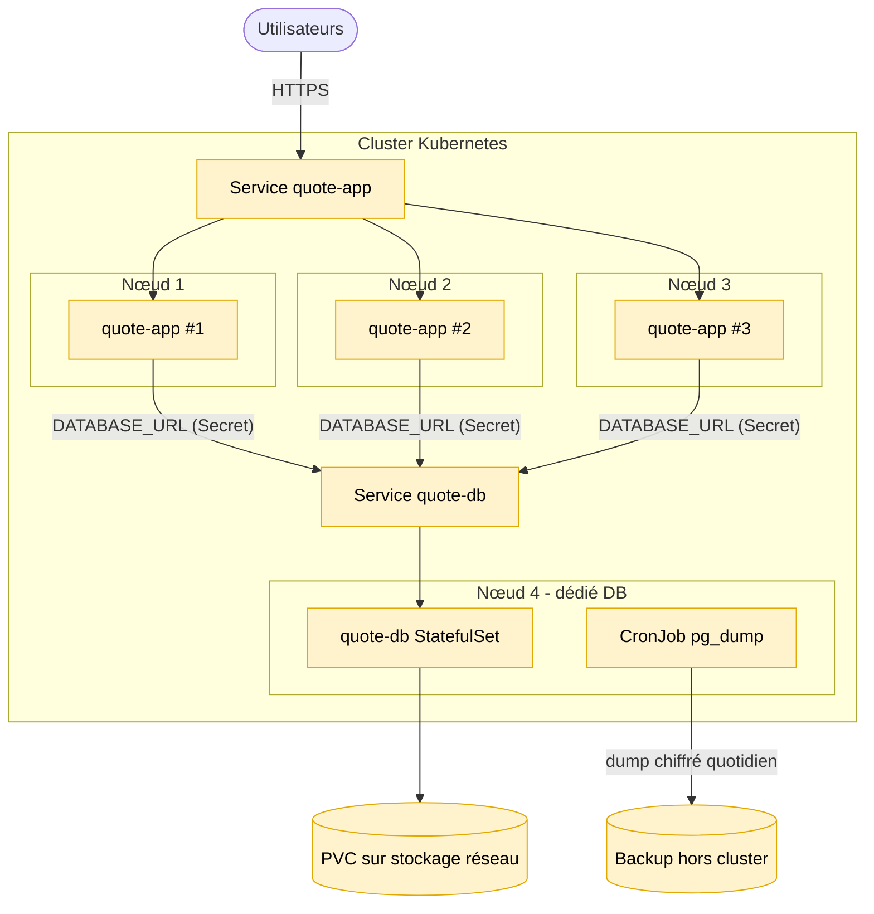

# Final Architecture - Lab 62

# Current System Problems

| # | Problème | Conséquence | Correctif proposé |
|---|----------|-------------|-------------------|
| 1 | Postgres dans le même conteneur que l'API | Tout redémarrage/recréation du conteneur efface la base. Impossible de scaler l'API sans dupliquer la base. | Deployment `quote-app` + StatefulSet `quote-db` avec un PVC. |
| 2 | Un seul Pod + stratégie `Recreate` | Chaque déploiement = coupure totale. un crash du Pod = service indisponible. | 3 réplicas + `RollingUpdate` (`maxUnavailable: 0`, `maxSurge: 1`). |
| 3 | Aucune probe | Kubernetes envoie du trafic à un Pod qui démarre ou qui est bloqué ; un process figé n'est jamais redémarré. | `readinessProbe` + `livenessProbe` sur `/health` (app). |
| 4 | Aucune limite de ressources | Un Pod qui fuit en mémoire peut affamer le nœud entier. | `resources.requests` + `limits` sur chaque conteneur. |
| 5 | Identifiants en clair dans le commit | Le mot de passe est dans l'historique Git pour toujours ; quiconque a accès au repo a accès à la base. | Secret Kubernetes référencé via `secretKeyRef`/`envFrom`, créé hors Git (Sealed Secrets / External Secrets) ; faire tourner le mot de passe fuité. |
| 6 | Un seul nœud / disque, pas de backup testé | Perte de la VM ou du disque = perte définitive des données et arrêt complet. | Plusieurs nœuds, stockage réseau, backups `pg_dump` hors cluster + test de restauration régulier. |

# Production Architecture

**Composants :**

- **Deployment `quote-app`** : 3 réplicas , probes `/health` , `RollingUpdate maxUnavailable: 0 / maxSurge: 1` , `requests/limits` , `topologySpreadConstraints` sur `kubernetes.io/hostname` pour répartir les Pods sur des nœuds différents , `PodDisruptionBudget minAvailable: 2` .
- **PostgreSQL** : workload séparé avec PVC et `pg_isready` -> passer en **StatefulSet** 1 réplica . Service `quote-db` interne uniquement.
- **Secrets** : l'app lit `DATABASE_URL` via `secretKeyRef` . Le Secret n'est jamais commité : créé via `kubectl create secret` en CI, ou chiffré avec **Sealed Secrets** / synchronisé depuis un coffre (Vault) via **External Secrets Operator** .
- **Frontières de panne** :
  - *Pod* -> géré par Kubernetes.
  - *Nœud/VM* -> 3 nœuds pour l'app (1 Pod par nœud) + 1 nœud dédié à la DB (`nodeSelector` + taint, pour que l'app ne lui vole pas CPU/RAM). La DB peut être replanifiée ailleurs seulement si son volume est sur du stockage réseau (pas `local-path`) et qu'un autre nœud accepte la DB (même label/toleration, ou on retire la contrainte en urgence).
  - *Disque / cluster entier* -> seul le backup hors cluster protège les données.

**Scénarios :**

- **Un Pod app tombe** : la liveness probe le redémarre ou le ReplicaSet le recrée. la readiness le sort du Service pendant ce temps -> les 2 autres Pods servent le trafic, pas de coupure.
- **Le Pod DB tombe** : le StatefulSet le recrée et remonte le même PVC -> données intactes (testé au Lab 52), mais coupure de quelques secondes (erreurs 500 côté app).
- **Une VM app est perdue** : les 2 autres Pods continuent ; le ReplicaSet recrée le 3ᵉ sur un nœud restant -> pas de coupure.
- **La VM / le disque de la DB est perdu** :
  - L'API répond mais renvoie des erreurs tant que la DB n'est pas revenue.
  - Avec `local-path` (mon Lab 52), le volume est détruit avec la VM -> restauration depuis le dernier `pg_dump` hors cluster dans un nouveau PVC -> perte des données depuis le dernier backup (RPO ≈ 24h si dump quotidien).
  - Avec stockage réseau, la DB redémarre sur un autre nœud avec ses données (perte de la VM seule, pas du disque).

# Operational Strategy

- **Déploiements sûrs** :
  - Image taguée par version, `RollingUpdate maxUnavailable: 0` : un nouveau Pod ne reçoit du trafic que lorsqu'il est *Ready*.
  - Si la readiness échoue, le rollout se bloque et les anciens Pods continuent de servir.
  - Vérifier : `kubectl rollout status deployment/quote-app`, logs, taux d'erreurs.
  - Rollback : `kubectl rollout undo deployment/quote-app`.
  - Le rollback ne revient qu'à l'ancienne image : il ne restaure pas les données et **n'annule pas une migration de schéma**. Donc : backup avant chaque migration, migrations rétro-compatibles (*expand/contract* : ajouter une colonne avant de supprimer l'ancienne) lancées dans un Job séparé. Données corrompues -> restauration depuis backup, pas rollback.
- **Détection des pannes** :
  - `readinessProbe` (retire le Pod du Service) ; `livenessProbe` (redémarre le conteneur) ; `pg_isready` pour la DB.
  - `kubectl get pods` / events (`CrashLoopBackOff`, `OOMKilled`).
  - Au-delà : monitoring (Prometheus + alertes sur erreurs 5xx, latence, disque plein, **échec du CronJob de backup**).
- **Contrôleurs de récupération** :
  - **kubelet** redémarre les conteneurs (liveness) ; **ReplicaSet** (via Deployment) maintient 3 Pods app ; **StatefulSet** recrée le Pod DB avec la même identité et le même PVC ; **node controller** marque un nœud mort et ses Pods sont replanifiés ailleurs.
  - **Hors de leur portée** : recréer une VM/disque perdu (infrastructure, IaC), restaurer des données (backup/restore manuel testé), annuler une migration.
- **Backup/restore** : CronJob `pg_dump` quotidien -> stockage objet sur un autre site, rétention 7 j ; **test de restauration mensuel** dans un namespace de test (un backup jamais restauré n'est pas un backup).

# Weakest Point

**PostgreSQL reste une instance unique.**

- Sous charge, c'est lui qui saturera en premier : toutes les réplicas de l'API partagent la même base (connexions, CPU, I/O disque). Ajouter des Pods app ne fait qu'**augmenter la pression** sur la DB.

